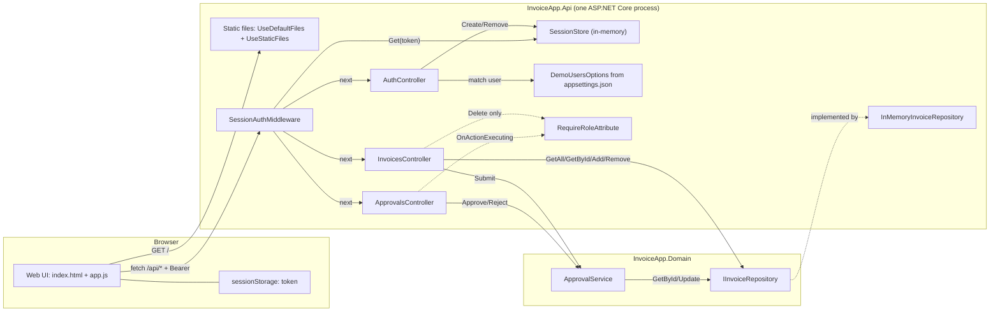
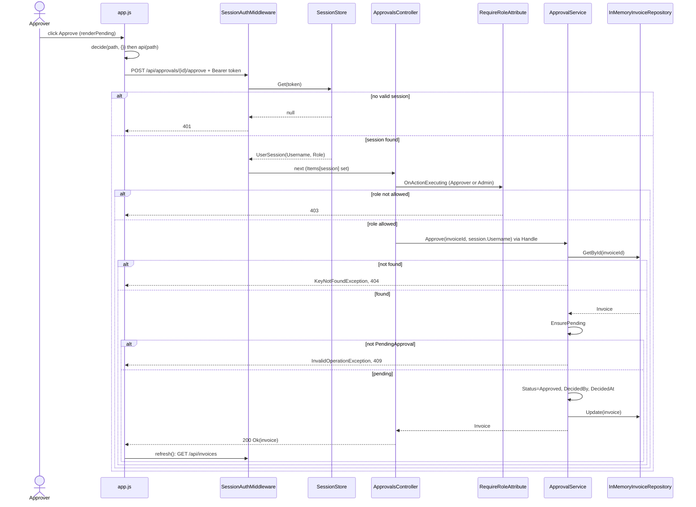

# As-built architecture (code only)

Sources: `backend/src/**` and `backend/src/InvoiceApp.Api/wwwroot/**` only. Nothing from `ops/` or `docs/` was used.
Paths below are relative to `backend/src/`. `API` = `InvoiceApp.Api`, `DOM` = `InvoiceApp.Domain`.

## 1. Container view

### Box citations

| Box | Citation |
|---|---|
| Web UI | `API/wwwroot/index.html` (`<script src="app.js">`, line 74); `API/wwwroot/app.js` (IIFE; `api()`, `decide()`, `renderPending()`, `refresh()`) |
| sessionStorage token | `API/wwwroot/app.js`: `sessionStorage.getItem/setItem('session')` in the IIFE and login submit handler |
| Static files | `API/Program.cs`: `app.UseDefaultFiles()`, `app.UseStaticFiles()` (lines 19-20) |
| SessionAuthMiddleware | `API/Auth/SessionAuthMiddleware.cs`: class `SessionAuthMiddleware`, `InvokeAsync`; registered `Program.cs:21` |
| SessionStore | `API/Auth/SessionStore.cs`: `Create`, `Get`, `Remove` over a `ConcurrentDictionary`; `AddSingleton` at `Program.cs:13` |
| AuthController | `API/Controllers/AuthController.cs`: `Login`, `Logout` |
| DemoUsersOptions | `API/Auth/UserSession.cs`: `DemoUsersOptions`, `DemoUser`; bound `Program.cs:12`; data in `API/appsettings.json` key `Users` |
| ApprovalsController | `API/Controllers/ApprovalsController.cs`: `Approve`, `Reject` |
| InvoicesController | `API/Controllers/InvoicesController.cs`: `GetAll`, `GetById`, `Create`, `Submit`, `Delete` |
| RequireRoleAttribute | `API/Auth/RequireRoleAttribute.cs`: `OnActionExecuting` |
| ApprovalService | `DOM/ApprovalService.cs`: `Submit`, `Approve`, `Reject`, `Find`, `EnsurePending`; `AddScoped` at `Program.cs:15` |
| IInvoiceRepository | `DOM/IInvoiceRepository.cs`; mapped to the in-memory class at `Program.cs:14` |
| InMemoryInvoiceRepository | `API/InMemoryInvoiceRepository.cs`: seeded `List<Invoice>` guarded by `lock`; methods `GetAll/GetById/GetByIds/Add/Update/Remove` |

### Arrow citations

| Arrow | Citation |
|---|---|
| UI → Static files `GET /` | `Program.cs:19-20` serve `wwwroot` (default file `index.html`) |
| UI → Middleware `fetch /api/* + Bearer` | `app.js` `api()`: `fetch('/api' + path)` with `headers.Authorization = 'Bearer ' + session.token` |
| UI — sessionStorage | `app.js`: `sessionStorage.setItem` (login), `removeItem` (`signOut`) |
| Middleware → SessionStore `Get(token)` | `SessionAuthMiddleware.InvokeAsync`: `_sessions.Get(token)` |
| Middleware → controllers `next` | `SessionAuthMiddleware.InvokeAsync`: `await _next(context)`; `Program.cs:22` `MapControllers()` |
| AuthController → SessionStore | `AuthController.Login`: `_sessions.Create(...)`; `Logout`: `_sessions.Remove(...)` |
| AuthController → DemoUsersOptions | `AuthController` ctor `IOptions<DemoUsersOptions>`; `Login`: `_options.Users.FirstOrDefault(...)` |
| ApprovalsController ⇢ RequireRole | `ApprovalsController.cs:9` `[RequireRole("Approver", "Admin")]` on the class |
| InvoicesController ⇢ RequireRole | `InvoicesController.Delete`: `[RequireRole("Admin")]` (this is the only usage in that controller) |
| ApprovalsController → ApprovalService | `ApprovalsController.Approve` / `Reject`: `_approvals.Approve(...)` / `_approvals.Reject(...)` |
| InvoicesController → ApprovalService | `InvoicesController.Submit`: `_approvals.Submit(id)` |
| InvoicesController → IInvoiceRepository | `InvoicesController.GetAll/GetById/Create/Delete`: `_repository.GetAll/GetById/Add/Remove` |
| ApprovalService → IInvoiceRepository | `ApprovalService.Find`: `_repository.GetById`; `Submit/Approve/Reject`: `_repository.Update` |
| IInvoiceRepository ⇢ InMemoryInvoiceRepository | `InMemoryInvoiceRepository : IInvoiceRepository`; `Program.cs:14` |
| API project → Domain project | `API/InvoiceApp.Api.csproj`: `<ProjectReference Include="..\InvoiceApp.Domain\InvoiceApp.Domain.csproj" />` |

## 2. Sequence: approve invoice

### Step citations

| # | Step | Citation |
|---|---|---|
| 1 | Click Approve | `app.js` `renderPending`: `approve.addEventListener('click', () => decide('/approvals/${invoice.id}/approve', {}))` |
| 2 | `decide` → `api` → POST | `app.js` `decide` (`api(path, { method: 'POST', body })`) and `api` (`fetch`, Bearer header) |
| 3 | Token lookup | `SessionAuthMiddleware.InvokeAsync`: needs a session when path starts with `/api` and is not `/api/auth/login`; parses `Bearer `; `_sessions.Get(token)` |
| 4 | 401 branch | `SessionAuthMiddleware.InvokeAsync`: `session is null` → `StatusCodes.Status401Unauthorized` |
| 5 | Session handed on | `SessionAuthMiddleware.InvokeAsync`: `context.Items[HttpContextExtensions.SessionKey] = session`, then `_next` |
| 6 | **Role check** | `ApprovalsController.cs:9` `[RequireRole("Approver", "Admin")]` → `RequireRoleAttribute.OnActionExecuting`: `session is null || !_roles.Contains(session.Role)` → `StatusCodeResult(403)` |
| 7 | Controller action | `ApprovalsController.Approve(string invoiceId)` (`[HttpPost("{invoiceId}/approve")]`) → `Handle(() => _approvals.Approve(invoiceId, HttpContext.GetSession().Username))` |
| 8 | Load invoice | `ApprovalService.Approve` → `Find` → `_repository.GetById` → `InMemoryInvoiceRepository.GetById` |
| 9 | 404 branch | `ApprovalService.Find` throws `KeyNotFoundException`; `ApiControllerBase.Handle` → `NotFound` |
| 10 | State guard | `ApprovalService.EnsurePending` throws `InvalidOperationException` unless `PendingApproval`; `Handle` → `Conflict` (409) |
| 11 | Mutate + persist | `ApprovalService.Approve`: `Status = Approved`, `DecidedBy = approver`, `DecidedAt = DateTime.UtcNow`, `_repository.Update` → `InMemoryInvoiceRepository.Update` |
| 12 | 200 response | `ApiControllerBase.Handle`: `Ok(action())`; enum serialised as string via `Program.cs:10` `JsonStringEnumConverter` |
| 13 | UI refresh | `app.js` `decide`: `await refresh()` → `api('/invoices')` → `InvoicesController.GetAll` (not drawn past the request arrow) |
| 14 | UI error display | `app.js` `decide` catch → `showError('decision-error', ...)` (not drawn) |

### Role check summary

- Who can approve: roles `Approver` or `Admin`. Declared at `ApprovalsController.cs:9`, enforced in `RequireRoleAttribute.OnActionExecuting`, compared against `UserSession.Role` (`API/Auth/UserSession.cs`).
- The role value comes from the user record in `API/appsettings.json` (`demo.approver` is Approver, `demo.admin` is Admin), copied into `UserSession` at `AuthController.Login`.
- The check is server-side only. `app.js` `renderPending` renders the Approve button for any signed-in user, with no role test. A user with any other role gets a 403 from the server.
- The same attribute also covers `Reject` (class-level).

## 3. INFERRED, not seen directly in code

1. "Browser" as the actor. Only the JS/HTML in `wwwroot` exists; that a browser runs it is implied.
2. "Containers" are logical groupings, not deployment units. `Program.cs` builds one `WebApplication`, so I drew one process. I did not look for a Dockerfile.
3. Execution order of middleware before MVC action filters (and `Ctl → Role`). The code never calls `RequireRoleAttribute` itself; ASP.NET Core invokes it as an action filter. The arrow from the controller to the attribute is a simplification of "framework runs the filter before the action".
4. Route `POST /api/approvals/{id}/approve`. Derived from `[Route("api/[controller]")]` plus `[HttpPost("{invoiceId}/approve")]`, with `[controller]` resolving to `approvals` by framework convention.
5. 404/409 arrows drawn from `ApprovalService` straight to the UI. In code the exception is thrown by the service, caught in `ApiControllerBase.Handle` in the controller, and converted to the response (step 9-10). The diagram compresses that hop.
6. State is lost on restart. Inferred from the in-memory `SessionStore` and `InMemoryInvoiceRepository`; no persistence code exists, but restart behaviour was not run.
7. After the 200 response, the final `refresh()` arrow to the middleware is shown as a new request. It also passes the same auth path and then `InvoicesController.GetAll`; I stopped the diagram at the request.

## 4. Not in the code (searched, left out)

A case-insensitive search of `backend/src` for database/DbContext/SQL, message bus (ServiceBus/Kafka/RabbitMQ), payment (Stripe/Payment), notification/email/SMTP and `HttpClient` found no usage. The only hit was the comment "no database" in `InMemoryInvoiceRepository.cs`. So the diagrams contain no database, message topic, payment provider or notification service.
