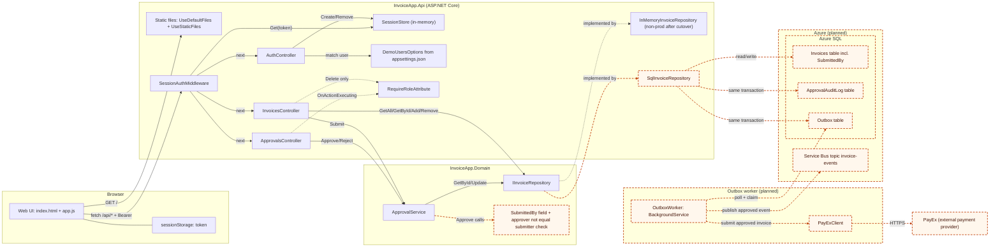

# Target-state container view (production)

Starting point: [`as-built.md`](as-built.md), which is what the code does today. This document keeps every component from that diagram and adds the planned production pieces.

Unlike the as-built view, this one deliberately draws on the scenario material in `ops/` and `docs/use-cases/`. Those describe the production version of the service, which is not in the code yet (`ops/README.md`, "A note on the scenario").

## Legend

- **Solid border** = exists in code today (see `as-built.md` for the citation of each box and arrow).
- **Dashed orange border** = `planned`, does not exist in code yet. Any arrow that touches a planned box is also drawn dashed orange.
- `ApprovalService` and the other existing boxes stay solid even where this plan changes them. Those changes are shown as planned boxes next to them and listed in the table.

## Diagram

The first 16 arrows and the 13 existing boxes are unchanged from `as-built.md`. Only `InMemoryInvoiceRepository` has a changed label.

## Planned elements and the scenario fact that requires each

| Planned element                                                           | Scenario fact that requires it                                                                                                                                                                                                                                                                                    | Source                                                                                                                                                                                         |
| ------------------------------------------------------------------------- | ----------------------------------------------------------------------------------------------------------------------------------------------------------------------------------------------------------------------------------------------------------------------------------------------------------------- | ---------------------------------------------------------------------------------------------------------------------------------------------------------------------------------------------- |
| **Azure SQL** (database container)                                        | The production version runs with "a database". Today the invoice store is an in-memory `List<Invoice>` seeded at startup, so data disappears on restart. The service also runs on three instances behind a load balancer, and a per-process list cannot be shared between them.                                   | `ops/README.md` (scenario note); `ops/incidents/INC-2041/README.md` ("three instances behind a load balancer"); as-built `InMemoryInvoiceRepository`                                           |
| **SqlInvoiceRepository** (implements `IInvoiceRepository`)                | `ApprovalService` and the controllers depend only on the `IInvoiceRepository` interface, so the SQL store plugs in behind it. `InMemoryInvoiceRepository` is kept, but is no longer the production implementation.                                                                                                | as-built §1 (`Program.cs:14`); the Azure SQL row above                                                                                                                                         |
| **Invoices table incl. `SubmittedBy`**                                    | Segregation of duties: SOC 2 will expect the person who approves to differ from the person who submitted. Today `Submit(invoiceId)` takes no user and `Invoice` has no `SubmittedBy`, so the data needed to enforce it does not exist.                                                                            | as-built §5 (self-approval finding); `ApprovalService.Submit`                                                                                                                                  |
| **SubmittedBy field + approver ≠ submitter check** (in `ApprovalService`) | Same fact. `ApprovalService.Approve` only runs `EnsurePending`, so a user in the Approver or Admin role can approve an invoice they submitted. `InvoicesController.Submit` would also need to pass the signed-in username to `Submit`.                                                                            | as-built §5; `ApprovalService.Approve` / `EnsurePending`                                                                                                                                       |
| **ApprovalAuditLog table**                                                | The business asks for an audit trail of who approved what and when. The 7-year audit requirement needs more than the two fields `Approve` overwrites today (`DecidedBy`, `DecidedAt`). INC-2047 also states that "the approval audit trail is complete" as part of the production system.                         | `docs/use-cases/UC-1-bulk-approval.md`; as-built §5 (audit-trail finding); `ops/incidents/INC-2047/alert.md`                                                                                   |
| **Outbox table**, written in the same SQL transaction as the approval     | Release 2.14.0 called PayEx inside the approval request. When PayEx calls failed (socket exhaustion, 100-second timeouts), approvals returned 5xx. The outbox lets an approval commit without calling PayEx. The approved status and the pending work are saved together, so neither can exist without the other. | `ops/incidents/INC-2041/alert.md` and `deploy-diff.patch`; `app-logs.txt`                                                                                                                      |
| **OutboxWorker** (`BackgroundService`)                                    | The PayEx submission moves out of the request path into a background process that retries. It reads unprocessed outbox rows, calls PayEx and publishes the event. With 3 API instances (and possibly more workers), rows have to be claimed so two workers do not submit the same invoice.                        | `ops/incidents/INC-2041/README.md`, `deploy-diff.patch` ("Adds the PayEx submission call to the approval path"); `ops/incidents/INC-2047/recent-changes.md` (retry policy, worker scaled to 2) |
| **PayExClient**                                                           | The approved invoices are submitted to PayEx, an external payment provider the service calls over HTTPS.                                                                                                                                                                                                          | `ops/README.md`; `ops/incidents/INC-2041/README.md`                                                                                                                                            |
| **PayEx** (external system)                                               | Same fact.                                                                                                                                                                                                                                                                                                        | `ops/README.md`; `ops/incidents/INC-2041/alert.md`                                                                                                                                             |
| **Azure Service Bus topic `invoice-events`**                              | "A message topic" is part of the production version. In production, approval events go to `invoice-events` on namespace `sb-invoice-prod`, and downstream consumers (`notification-worker`, `analytics-export`, `audit-archive`) subscribe to it.                                                                 | `ops/README.md`; `ops/incidents/INC-2047/servicebus-status.txt`, `publisher-logs.txt`                                                                                                          |

## Design choices made in this diagram (not stated by the scenario)

1. **One worker does both jobs.** The worker submits to PayEx and also publishes the approved event. The brief says the worker submits to PayEx and lists Service Bus as a separate element. I connected the worker to the topic because INC-2047 shows an `EventPublisher` that publishes `InvoiceApproved`, and the outbox is the natural source for it. If PayEx and Service Bus should each have their own worker or outbox row type, the diagram needs splitting.
2. **The repository writes all three tables.** `SqlInvoiceRepository` writes the invoice, the audit row and the outbox row in one SQL transaction. That is why there is no separate audit or outbox port in `InvoiceApp.Domain`. A cleaner design might add ports for them, which would be a Domain-layer change.
3. **Where the worker runs.** It is drawn as its own group. Whether it is a separate host or a hosted service in the API process is undecided here. If it runs inside the API, each of the 3 instances polls the outbox, and the claim step is required.

## Not drawn

- The other topic subscribers named in INC-2047 (`notification-worker`, `analytics-export`, `audit-archive`). They are consumers outside this service and were not part of the request.
- The `SessionStore` stays in-memory per instance, as in the code today. With 3 instances behind a load balancer, a sign-in on one instance is not known to the others. I kept the component unchanged because the brief says to keep every existing component and asked for no change to it. This is worth a decision.
- Second approver for invoices over $1,000, bulk approval and partial approval (`UC-1`, `UC-2`). They are feature briefs and not part of this brief.

## My check

- Compared every box with as-built.md. Solid = exists today, dotted = planned.
- All correct.
